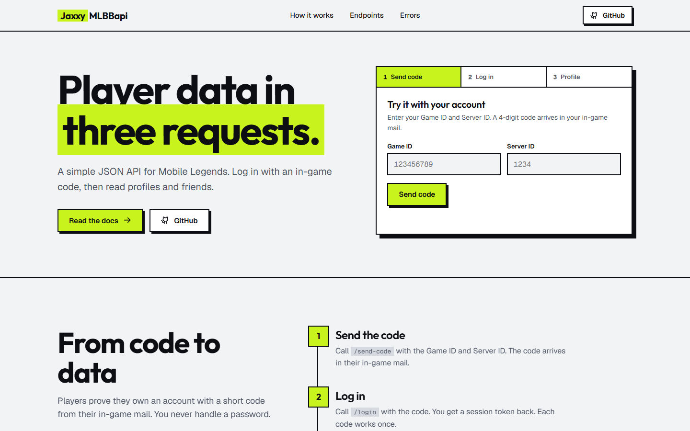
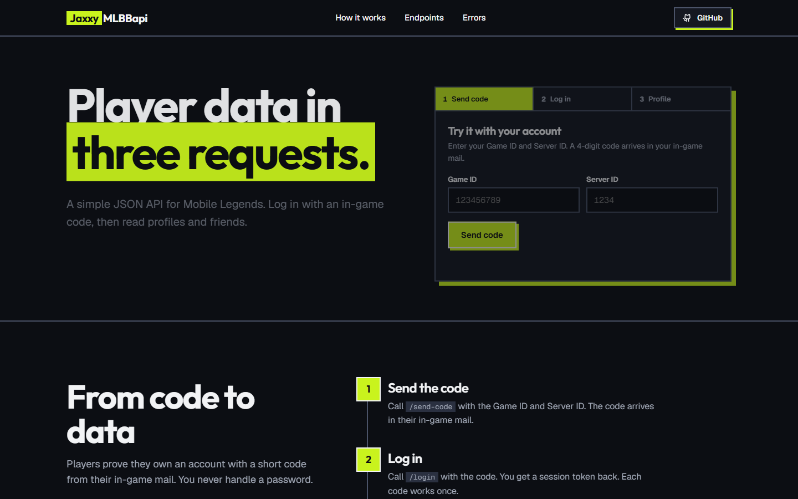
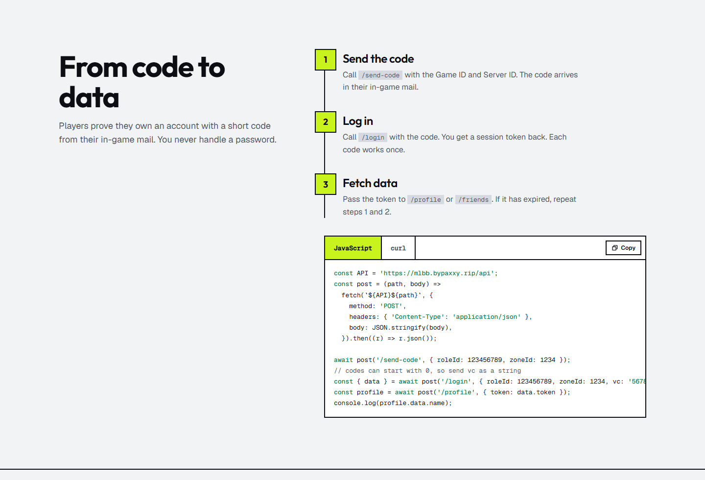
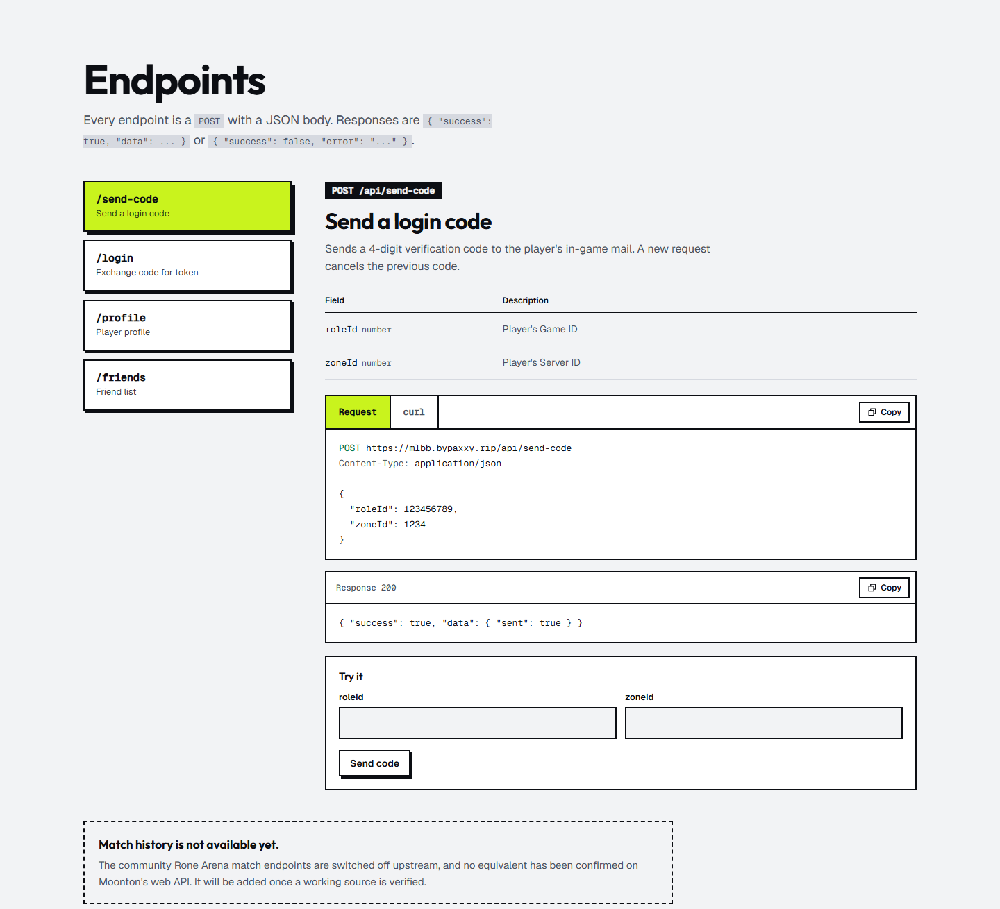
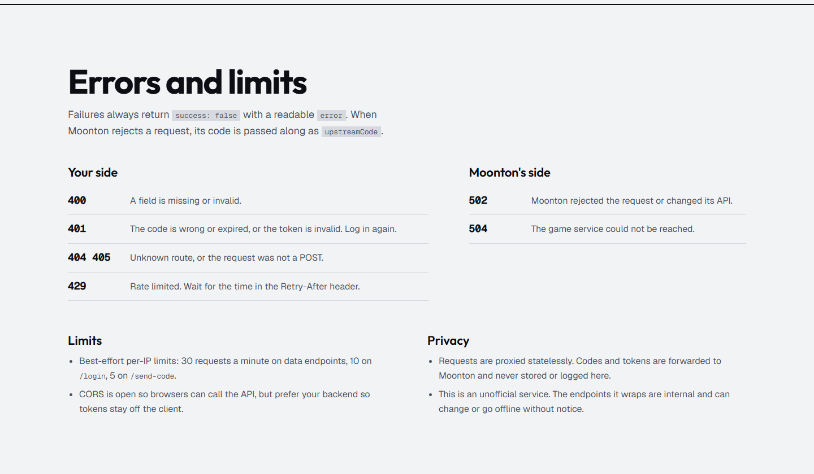
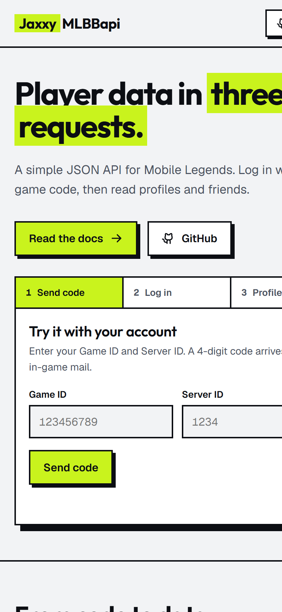
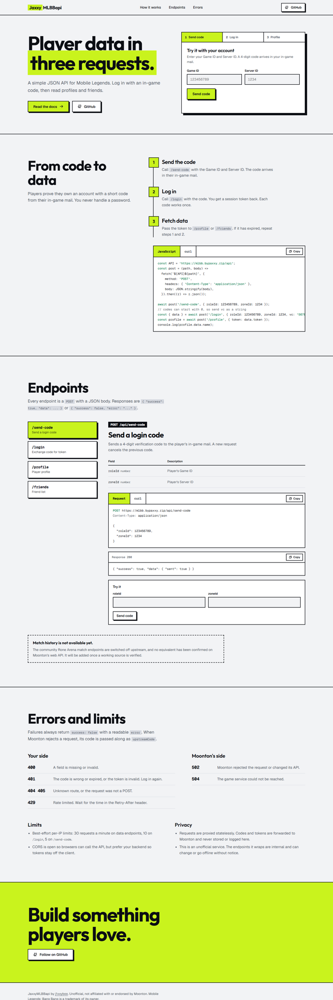

<div align="center">

# MLBB Profile Fetcher

**A free, unofficial JSON API for Mobile Legends: Bang Bang.**
Log in with an in-game code, then read a player's profile and friend list in three requests.

[](https://mlbb.bypaxxy.rip/)
[](https://mlbb.bypaxxy.rip/#endpoints)
[](https://mlbb.bypaxxy.rip/)

**[🌐 Open the website](https://mlbb.bypaxxy.rip/)** · **[📖 Docs](https://mlbb.bypaxxy.rip/#endpoints)** · **[⚠️ Errors & limits](https://mlbb.bypaxxy.rip/#errors)**



</div>

---

## Contents

- [What it does](#what-it-does)
- [Screenshots](#screenshots)
- [How it works](#how-it-works)
- [Base URL](#base-url)
- [Endpoints](#endpoints)
  - [`POST /api/send-code`](#post-apisend-code)
  - [`POST /api/login`](#post-apilogin)
  - [`POST /api/profile`](#post-apiprofile)
  - [`POST /api/friends`](#post-apifriends)
- [Full examples](#full-examples) (curl · JavaScript · Python)
- [Errors](#errors)
- [Rate limits](#rate-limits)
- [Privacy](#privacy)
- [Disclaimer](#disclaimer)

---

## What it does

**MLBB Profile Fetcher** (JaxxyMLBBapi) lets you fetch a Mobile Legends player's account data with plain HTTP calls:

| Data | Endpoint |
| --- | --- |
| Nickname, avatar, account level | `/api/profile` |
| Current rank level and highest (history) rank level | `/api/profile` |
| Registration country | `/api/profile` |
| Friend list (names and avatars) | `/api/friends` |

Players prove they own the account with a 4‑digit code sent to their **in‑game mail**. No password is ever involved.

You can try it live on the website without writing any code: enter a Game ID and Server ID, type the code from your in‑game mail, and your profile shows up.

---

## Screenshots

| Light | Dark |
| :---: | :---: |
|  |  |

<details open>
<summary><b>How it works</b></summary>
<br>

</details>

<details open>
<summary><b>Interactive endpoint docs</b></summary>
<br>

</details>

<details>
<summary><b>Errors and limits</b></summary>
<br>

</details>

<details>
<summary><b>Mobile</b></summary>
<br>
<p align="center"></p>
</details>

<details>
<summary><b>Full page</b></summary>
<br>
<p align="center"></p>
</details>

---

## How it works

```
 ┌──────────────┐      ┌──────────────┐      ┌──────────────────────┐
 │ 1. send-code │ ───▶ │   2. login   │ ───▶ │ 3. profile / friends │
 │ roleId+zone  │      │ + 4-digit vc │      │       + token        │
 └──────────────┘      └──────────────┘      └──────────────────────┘
   code arrives in        returns a            returns player data
   in-game mail           session token
```

1. **Send the code** – call `/send-code` with the Game ID and Server ID. A 4‑digit code arrives in the player's in‑game mail.
2. **Log in** – call `/login` with that code. You get a session token back. Each code works once and lasts 5 minutes.
3. **Fetch data** – pass the token to `/profile` or `/friends`. If the token has expired, repeat steps 1 and 2.

> **Where do I find my IDs?** In MLBB, tap your avatar (top left). The number shown is your **Game ID** (`roleId`); the number in brackets is your **Server ID** (`zoneId`). Example: `123456789 (1234)`.

---

## Base URL

```
https://mlbb.bypaxxy.rip/api
```

- Every endpoint is a **`POST`** with a **JSON** body (`Content-Type: application/json`).
- Every response has one of two shapes:

```json
{ "success": true,  "data": { ... } }
```

```json
{ "success": false, "error": "Human readable message" }
```

---

## Endpoints

### `POST /api/send-code`

Sends a 4‑digit verification code to the player's in‑game mail. A new request cancels the previous code.

| Field | Type | Description |
| --- | --- | --- |
| `roleId` | number | Player's Game ID |
| `zoneId` | number | Player's Server ID |

```bash
curl -X POST https://mlbb.bypaxxy.rip/api/send-code \
  -H "Content-Type: application/json" \
  -d '{"roleId":123456789,"zoneId":1234}'
```

**Response `200`**

```json
{ "success": true, "data": { "sent": true } }
```

---

### `POST /api/login`

Exchanges the code for a session token. **Treat the token like a password**: keep it server‑side, because it grants access to the player's session until it expires.

| Field | Type | Description |
| --- | --- | --- |
| `roleId` | number | Player's Game ID |
| `zoneId` | number | Player's Server ID |
| `vc` | string | The code from in‑game mail. Send it as a **string**, it may start with `0`. |

```bash
curl -X POST https://mlbb.bypaxxy.rip/api/login \
  -H "Content-Type: application/json" \
  -d '{"roleId":123456789,"zoneId":1234,"vc":"5678"}'
```

**Response `200`**

```json
{
  "success": true,
  "data": { "token": "eyJ...", "roleId": 123456789, "zoneId": 1234 }
}
```

---

### `POST /api/profile`

Returns the player's name, avatar, level, rank levels and registration country.

| Field | Type | Description |
| --- | --- | --- |
| `token` | string | Token from `/login` |

```bash
curl -X POST https://mlbb.bypaxxy.rip/api/profile \
  -H "Content-Type: application/json" \
  -d '{"token":"PLAYER_TOKEN"}'
```

**Response `200`**

```json
{
  "success": true,
  "data": {
    "name": "Player",
    "avatar": "https://akmpicture.youngjoygame.com/...",
    "level": 127,
    "rankLevel": 71,
    "historyRankLevel": 276,
    "country": "DZ",
    "roleId": 123456789,
    "zoneId": 1234
  }
}
```

| Field | Meaning |
| --- | --- |
| `name` | In‑game nickname |
| `avatar` | Avatar image URL |
| `level` | Account level |
| `rankLevel` | Current season rank level |
| `historyRankLevel` | Highest rank level ever reached |
| `country` | Registration country (ISO code) |
| `roleId` / `zoneId` | Game ID / Server ID |

---

### `POST /api/friends`

Returns the player's friend list. Names and avatars only; friend IDs are hashed upstream.

| Field | Type | Description |
| --- | --- | --- |
| `token` | string | Token from `/login` |

```bash
curl -X POST https://mlbb.bypaxxy.rip/api/friends \
  -H "Content-Type: application/json" \
  -d '{"token":"PLAYER_TOKEN"}'
```

**Response `200`**

```json
{
  "success": true,
  "data": {
    "friends": [
      { "name": "Player", "avatar": "https://..." }
    ]
  }
}
```

> **Match history** is not available yet. The community endpoints for it are switched off upstream; it will be added once a working source is verified.

---

## Full examples

### curl

```bash
# 1. send the code to in-game mail
curl -X POST https://mlbb.bypaxxy.rip/api/send-code \
  -H "Content-Type: application/json" \
  -d '{"roleId":123456789,"zoneId":1234}'

# 2. log in with the code from your mail
curl -X POST https://mlbb.bypaxxy.rip/api/login \
  -H "Content-Type: application/json" \
  -d '{"roleId":123456789,"zoneId":1234,"vc":"5678"}'

# 3. use the token
curl -X POST https://mlbb.bypaxxy.rip/api/profile \
  -H "Content-Type: application/json" \
  -d '{"token":"PLAYER_TOKEN"}'

curl -X POST https://mlbb.bypaxxy.rip/api/friends \
  -H "Content-Type: application/json" \
  -d '{"token":"PLAYER_TOKEN"}'
```

### JavaScript (browser or Node 18+)

```js
const API = 'https://mlbb.bypaxxy.rip/api';

const post = async (path, body) => {
  const res = await fetch(`${API}${path}`, {
    method: 'POST',
    headers: { 'Content-Type': 'application/json' },
    body: JSON.stringify(body),
  });
  const json = await res.json();
  if (!json.success) throw new Error(`${res.status}: ${json.error}`);
  return json.data;
};

const roleId = 123456789;
const zoneId = 1234;

// 1. send the code
await post('/send-code', { roleId, zoneId });

// 2. log in (codes can start with 0, so send vc as a string)
const { token } = await post('/login', { roleId, zoneId, vc: '5678' });

// 3. fetch data
const profile = await post('/profile', { token });
const { friends } = await post('/friends', { token });

console.log(`${profile.name} | Lv.${profile.level} | ${profile.country}`);
console.log(`${friends.length} friends`);
```

### Python

```python
import requests

API = "https://mlbb.bypaxxy.rip/api"

def post(path, body):
    r = requests.post(f"{API}{path}", json=body, timeout=15)
    data = r.json()
    if not data.get("success"):
        raise RuntimeError(f"{r.status_code}: {data.get('error')}")
    return data["data"]

role_id, zone_id = 123456789, 1234

# 1. send the code to in-game mail
post("/send-code", {"roleId": role_id, "zoneId": zone_id})

# 2. log in with the code (keep it a string)
vc = input("Code from in-game mail: ").strip()
token = post("/login", {"roleId": role_id, "zoneId": zone_id, "vc": vc})["token"]

# 3. fetch data
profile = post("/profile", {"token": token})
friends = post("/friends", {"token": token})["friends"]

print(f"{profile['name']} | Lv.{profile['level']} | rank {profile['rankLevel']} | {profile['country']}")
for f in friends:
    print(" -", f["name"])
```

---

## Errors

Failures always return `success: false` with a readable `error`. When Moonton rejects a request, its code is passed along as `upstreamCode`.

```json
{ "success": false, "error": "A session token is required." }
```

| Status | Side | Meaning |
| --- | --- | --- |
| `400` | yours | A field is missing or invalid. |
| `401` | yours | The code is wrong or expired, or the token is invalid. Log in again. |
| `404` / `405` | yours | Unknown route, or the request was not a `POST`. |
| `429` | yours | Rate limited. Wait for the time in the `Retry-After` header. |
| `502` | Moonton | Moonton rejected the request or changed its API. |
| `504` | Moonton | The game service could not be reached. |

---

## Rate limits

Best‑effort, per IP:

| Endpoint | Limit |
| --- | --- |
| `/send-code` | 5 requests / minute |
| `/login` | 10 requests / minute |
| `/profile`, `/friends` | 30 requests / minute |

CORS is open so browsers can call the API directly, but prefer calling it from your backend so tokens stay off the client.

---

## Privacy

Requests are proxied statelessly. Codes and tokens are forwarded to Moonton and are **never stored or logged**.

---

## Disclaimer

This is an **unofficial** service, not affiliated with or endorsed by Moonton. The endpoints it wraps are internal and can change or go offline without notice. *Mobile Legends: Bang Bang* is a trademark of its owner.

<div align="center">

Made by **[j1xxyboo](https://github.com/j1xxyboo)** · **[mlbb.bypaxxy.rip](https://mlbb.bypaxxy.rip/)**

If this helped you, leave a ⭐

</div>
